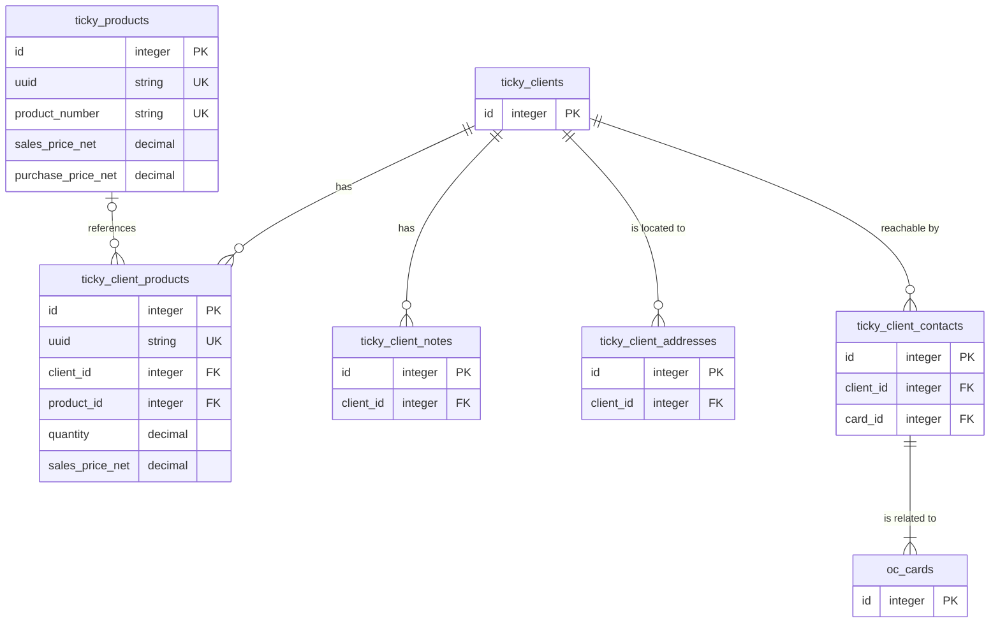

# Database documentation

## ER Diagram

## Table: ticky_clients
Client / customer informations

| Column | Type | Options | Constraints | Meaning |
|---|---|---|---|---|
| id | integer | autoincrement, unsigned | PK | Client identifier |
| uuid | string | length=36, notnull | Unique IDX | Client external identifier |
| client_number | string | length=36, notnull | Unique IDX | Client number |
| name | string | length=255, notnull |  | Client name |
| type | string | length=32, notnull, default=company |  | Client type |
| status | string | length=32, notnull, default=lead |  | Client status: lead, active, inactive |
| contact_email | string | length=255 |  | Client contact email address |
| invoice_email | string | length=255 |  | Client invoice email address |
| phone | string | length=64 |  | Client contact phone number |
| website | string | length=255 |  | Client website URL |
| vat_id | string | length=32 |  | ??? |
| tax_number | string | length=64 |  | ??? |
| register_court | string | length=255 |  | ??? |
| register_number | string | length=64 |  | ??? |
| nc_file_id | integer | unsigned |  | ??? |
| nc_folder_path | string | length=512 |  | ??? |
| created_at | datetime |  |  | Client record create date |
| updated_at | datetime |  |  | Client record update date |

## Table: ticky_client_notes
Client / customer notes

| Column | Type | Options | Constraints | Meaning |
|---|---|---|---|---|
| id | integer | autoincrement, unsigned | PK | Client note identifier |
| client_id | integer | unsigned, notnull | FK CascadeDelete | Client identifier |
| user_id | string | length=64, notnull |  | Client identifier |
| type | string | length=32, default=note |  | Client note type |
| title | string | length=255 |  | Client note title |
| content | text | notnull |  | Client note content |
| created_at | datetime |  |  | Client note record create date |
| updated_at | datetime |  |  | Client note record update date |

## Table: ticky_client_addresses
Client / customer addresses

| Column | Type | Options | Constraints | Meaning |
|---|---|---|---|---|
| id | integer | autoincrement, unsigned | PK | Client address identifier |
| client_id | integer | unsigned, notnull | FK CascadeDelete | Client identifier |
| type | string | length=32, default=main | IDX (with client_id) | Client address type |
| label | string | length=255 |  | Client address label |
| street | string | length=255, notnull |  | Client address street name |
| house_number | string | length=32 |  | Client address house number |
| address_addition | string | length=255 |  | Client address addition |
| postal_code | string | length=32, notnull |  | Client address postal code |
| city | string | length=255, notnull |  | Client address city name |
| country_code | string | length=2, default=DE |  | Client address country code |
| created_at | datetime |  |  | Client address record create date |
| updated_at | datetime |  |  | Client address record update date |

## Table: ticky_client_contacts
Client / customer contacts

| Column | Type | Options | Constraints | Meaning |
|---|---|---|---|---|
| id | integer | autoincrement, length=11 | PK | Client contact identifier |
| client_id | integer | unsigned, notnull | FK CascadeDelete | Client identifier |
| card_id | integer | length=11, notnull | FK | Nextcloud contact identifier |
| created_at | datetime |  |  | Client contact record create date |
| updated_at | datetime |  |  | Client contact record update date |

Why no cascaded delete for oc_card?

## Table: ticky_products

Current product catalog, independent of customers. Net prices are per unit in
the same currency. Decimal values remain strings in PHP and JSON.

| Column | Type | Options | Constraints | Meaning |
|---|---|---|---|---|
| id | integer | autoincrement, unsigned, notnull | PK | Internal identifier |
| uuid | string | length=36, notnull | Unique IDX | External identifier |
| product_number | string | length=64, notnull | Unique IDX | Article number |
| name | string | length=255, notnull | IDX | Product name |
| description | text | nullable | | Customer-facing description |
| type | string | length=32, default=product, notnull | | product, service, digital |
| procurement_type | string | length=32, nullable | | in_house or external (including resale) |
| category | string | length=255, nullable | | Free-text category |
| unit | string | length=32, notnull | | e.g. piece, hour, day, month, kg, m |
| status | string | length=32, default=active, notnull | IDX | active or archived |
| currency | string | length=3, notnull | | ISO 4217 code, e.g. EUR |
| sales_price_net | decimal | precision=19, scale=4, notnull | | Current standard net sales price |
| sales_tax_rate | decimal | precision=5, scale=2, notnull | | Sales tax percentage, e.g. 19.00 |
| purchase_price_net | decimal | precision=19, scale=4, nullable | | Current standard net purchase price |
| purchase_tax_rate | decimal | precision=5, scale=2, nullable | | Purchase tax percentage |
| internal_note | text | nullable | | Internal information |
| created_at | datetime | notnull | | Creation time |
| updated_at | datetime | notnull | | Last modification time |

`NULL` purchase values mean unknown; zero means a known zero amount/rate.
ProductService validates types, status, field lengths, currency-code format,
nonnegative prices and tax rates (0-100%). The schema uses strings/decimals instead of database enums.
Customer sales positions copy the agreed price, tax rate, currency, unit and
optional purchase cost. Catalog changes do not change existing positions.
No separate product price history is stored.

Product dropdown lists are stored in Nextcloud app configuration under
`ticky_crm/product_options`. Categories, types, procurement, status, units and
currencies use stable values with editable labels. Defaults apply until configured.
Only admins can save lists; CRM users can read them. Retired values remain valid
on unchanged existing products. The `active` and `archived` status values are required.

## Table: ticky_client_products

Customer sales positions. Each assignment copies product name, article number,
unit, currency and current purchase/sales prices and tax rates. Actual agreed
prices and quantity can be edited independently. Multiple positions may reference
the same product. Catalog edits never modify saved positions.

| Column | Type | Meaning |
|---|---|---|
| id | unsigned integer, autoincrement PK | Internal identifier |
| uuid | string(36), unique | External identifier |
| client_id | unsigned integer, notnull FK | Customer; cascade delete |
| product_id | unsigned integer, nullable FK | Catalog product; set NULL on deletion |
| product_number | string(64), notnull | Copied article number |
| name | string(255), notnull | Copied product name |
| unit | string(32), notnull | Copied unit |
| currency | string(3), notnull | Copied currency |
| quantity | decimal(19,4), notnull | Positive quantity |
| sales_price_net | decimal(19,4), notnull | Agreed net sales price per unit |
| sales_tax_rate | decimal(5,2), notnull | Sales tax percentage |
| purchase_price_net | decimal(19,4), nullable | Purchase cost per unit at assignment |
| purchase_tax_rate | decimal(5,2), nullable | Purchase tax percentage |
| created_at, updated_at | datetime, notnull | Creation and last change |

Decimal inputs and displays always use a comma; API/database values remain exact
decimal strings with a dot. Removing an assignment leaves the catalog unchanged.
